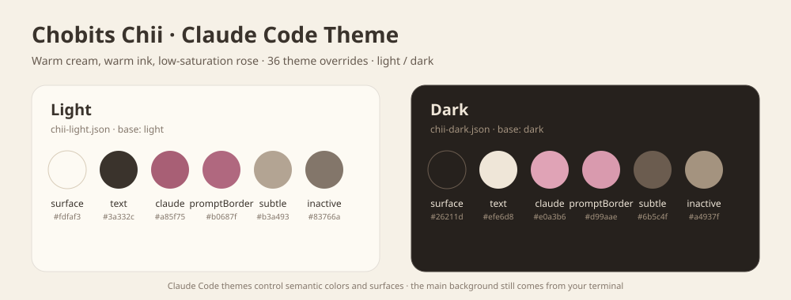

<div align="center">
  <h1>Chobits-Chii-Claude</h1>
  <p><b>Chii~</b> A Chii-themed warm palette for Claude Code</p>
  <p>A Chii-themed theme plugin for Claude Code.</p>
  <p>
    <a href="https://github.com/Anime2Real/Chobits-Chii-Claude"></a>
    <a href="LICENSE"></a>
    <a href="https://github.com/topics/claude-code"></a>
    <a href="https://github.com/topics/claude-plugin"></a>
    <a href=".claude-plugin/plugin.json"></a>
  </p>
  <p>
    <a href="./README.md">简体中文</a> ｜ <a href="./README.ja.md">日本語</a> ｜ <a href="./README.en.md">English</a>
  </p>
</div>

<p align="center">
  
</p>

> **This repository ships color values and plugin scripts only. It does not include character artwork, Live2D models, or other visual assets.** The palette is derived from the MIT-licensed code of [Chobits-Chii-DSH](https://github.com/Anime2Real/Chobits-Chii-DSH) and ported to Claude Code via [Chobits-Chii-Kimi](https://github.com/Anime2Real/Chobits-Chii-Kimi). Chobits and Chii are © CLAMP and the relevant rights holders.

> **Claude Code plugin themes are still experimental.** Select a theme with `/theme`; a plugin cannot switch it for you and does not follow the system light/dark setting. The terminal's main background is controlled by your terminal emulator, not by the theme.

## ✨ Features

- **Neutral warm palette**: warm cream, warm ink text, and low-saturation rose accents, tuned for comfortable long terminal sessions
- **Light and dark themes**: `chii-light` and `chii-dark`, each with the matching `base` value so unspecified tokens inherit the correct built-in palette
- **36 theme tokens**: brand accents, body text, borders, mode indicators, diffs, message surfaces, usage meters, labels, and shimmer
- **Packaged as a plugin**: one `.claude-plugin/plugin.json` bundles the themes, a slash command, a skill, and a marketplace manifest
- **Native theme discovery**: Claude Code scans the plugin's `themes/` directory, so `/theme` lists both themes without the sync hook used by the Kimi version
- **Zero dependencies**: the validation script uses Node built-ins only; there is no build step and no runtime dependency
- **Validated**: `scripts/validate.mjs` checks the manifest, marketplace, skill/command frontmatter, token names, and color values

## 🚀 Install

Requires Claude Code (validated and locally installed with **2.1.326**). In a Claude Code session, run:

```text
/plugin marketplace add Anime2Real/Chobits-Chii-Claude
/plugin install chobits-chii@chobits-chii
```

Then run:

```text
/theme
```

Pick one of:

- `Chobits Chii (Light)`
- `Chobits Chii (Dark)`

### Local development

```bash
claude --plugin-dir ./Chobits-Chii-Claude
```

Use `/theme` as above. Restart the session after editing local source files.

### Theme files only

If you only want the palette without the plugin:

```bash
mkdir -p ~/.claude/themes
cp themes/*.json ~/.claude/themes/
```

If both the plugin and the copied themes are present, `/theme` shows duplicate names; keep one source.

### Uninstall

```bash
claude plugin uninstall chobits-chii@chobits-chii
```

You can also uninstall from the **Installed** tab in `/plugin`. This does not delete themes you copied to `~/.claude/themes/`.

## 🎨 Usage

| Command | Description |
| --- | --- |
| `/theme` | Open the theme picker and select `Chobits Chii (Light)` or `Chobits Chii (Dark)` |
| `/chobits-chii:theme` | Validate the themes and show how to switch |
| `/chobits-chii:chobits-chii` | Load the plugin skill for application and customization notes |
| `claude plugin validate .` | Validate the manifest, paths, and theme files |
| `claude --plugin-dir .` | Load the plugin from a local directory without installing |

Theme selection is interactive. The plugin never claims to have switched the theme for you. This plugin does not switch themes automatically; select a custom theme manually in `/theme`.

## 🔧 How it works

Claude Code natively supports plugin-contributed themes: it scans `themes/` at the plugin root and lists the files in `/theme`. This plugin therefore does not need the `SessionStart` sync hook used by the Kimi version:

```text
.claude-plugin/plugin.json
├─ themes/chii-light.json   ──▶  /theme → Chobits Chii (Light)
├─ themes/chii-dark.json    ──▶  /theme → Chobits Chii (Dark)
├─ commands/theme.md        ──▶  /chobits-chii:theme
└─ skills/chobits-chii/     ──▶  /chobits-chii:chobits-chii
```

When installed, Claude Code copies the repository into its plugin cache and loads the themes with the plugin. `/theme` re-reads the available themes each time it opens; files in `~/.claude/themes/` are watched and reloaded automatically.

## 🧩 Palette

Both themes override 36 tokens. Key mappings below; the full set is in [`themes/chii-light.json`](themes/chii-light.json) and [`themes/chii-dark.json`](themes/chii-dark.json):

| Token | Light | Dark | Purpose |
| --- | --- | --- | --- |
| `claude` | `#a85f75` | `#e0a3b6` | Brand accent, spinner, assistant label |
| `text` | `#3a332c` | `#efe6d8` | Body text, dialogs, Markdown |
| `inactive` | `#83766a` | `#a4937f` | Secondary text, hints, timestamps |
| `subtle` | `#b3a493` | `#6b5c4f` | Faint borders, dividers, symbols |
| `promptBorder` | `#b0687f` | `#d99aae` | Input box border |
| `planMode` | `#b0687f` | `#d99aae` | Plan mode accent |
| `bashBorder` | `#b0687f` | `#d99aae` | `!` shell mode border |
| `diffAdded` | `#e8f0e2` | `#1f2b22` | Added-line background |
| `diffRemoved` | `#f6e4e6` | `#332226` | Removed-line background |
| `userMessageBackground` | `#f3eae1` | `#2c2520` | User message surface |
| `selectionBg` | `#e6d3d6` | `#4a383c` | Mouse selection background |
| `rate_limit_fill` | `#a85f75` | `#e0a3b6` | Usage meter fill |
| `briefLabelYou` | `#a85f75` | `#e0a3b6` | User label |
| `claudeShimmer` | `#c68fa1` | `#f2c6d2` | Spinner shimmer |

Semantic colors such as `success`, `error`, and `warning` are left at the built-in values so their meaning stays clear.

### Token mapping from Kimi

| Kimi token | Claude token |
| --- | --- |
| `primary` | `claude` |
| `text` | `text` |
| `textMuted` | `inactive` |
| `border` | `subtle` |
| `borderFocus` | `promptBorder` |
| `roleUser` | `briefLabelYou` |
| `shellMode` | `bashBorder` |
| `diffGutter` / `diffMeta` | No direct equivalent; diff surfaces carry the same intent |

Claude Code themes control semantic surfaces such as messages, the prompt, and diffs, but **the terminal's main background still comes from your terminal emulator**. The DSH skin's cream page background, photo wall, noise texture, rounded font, selection state, and Live2D mascot are not included: Claude Code themes cannot inject web UI. Restyling the whole interface would require a Claude Code mod, which is a different API.

## 🎨 Customize

Do not edit the installed plugin copy; updates replace it. Copy a theme into your user theme directory:

```bash
mkdir -p ~/.claude/themes
cp themes/chii-light.json ~/.claude/themes/chii-light-mine.json
$EDITOR ~/.claude/themes/chii-light-mine.json
```

- Change the filename and the `name` field together, for example `"Chii Light Mine"`, to avoid colliding with the plugin theme
- Keep `base` as `light` or `dark`; edit only `overrides`
- Accepted values: `#rrggbb`, `#rgb`, `rgb(r,g,b)`, `ansi256(n)`, and `ansi:<name>`; unknown tokens and invalid colors are ignored
- Claude Code watches `~/.claude/themes/` and reloads changes. If the directory did not exist at startup, restart once after creating it
- To change the defaults and submit them back, edit `themes/*.json`, run `node scripts/validate.mjs`, and open a PR

## 🛠 Development

```bash
node scripts/validate.mjs                               # local manifest/marketplace/theme checks
npx @anthropic-ai/claude-code plugin validate .         # official Claude Code validation
npx @anthropic-ai/claude-code --plugin-dir .            # load from the local directory
```

Layout:

```text
.claude-plugin/plugin.json      # Claude Code plugin manifest
.claude-plugin/marketplace.json # marketplace manifest
themes/chii-light.json          # light theme
themes/chii-dark.json           # dark theme
commands/theme.md               # /chobits-chii:theme
skills/chobits-chii/SKILL.md    # plugin skill
scripts/validate.mjs            # manifest and theme validation, Node built-ins only
assets/icon.svg / icon.png      # plugin icon
docs/palette.svg                # README palette preview
LICENSE                         # MIT
NOTICE                          # palette provenance and character rights
```

With `--plugin-dir`, restart the session after source edits. A marketplace-installed copy needs a reinstall or a version update.

## 🧱 Compatibility and limits

- **Themes are experimental**: Claude Code exposes plugin themes under `experimental.themes`; fields and tokens may change
- **Terminal UI only**: themes affect Claude Code's terminal rendering; support in the Desktop Code tab and VS Code extension depends on those versions
- **Background is not themed**: the terminal's main background is controlled by the terminal; Claude themes only cover semantic surfaces
- **No automatic light/dark switching**: select a theme manually with `/theme`
- **No auto-selection**: installing the plugin does not activate a theme
- **Custom themes live in `~/.claude/themes/`**: do not edit the plugin cache
- **Install scopes**: user, project, and local scopes are supported; teams can pin the plugin per project

## 🗺 Roadmap

- **v1.0.0 (current)**: two themes, plugin manifest, marketplace, command, skill, validation script
- **v1.1**: contrast and accessibility audit; high-contrast and low-saturation variants
- **v1.2**: Claude Code plugin directory listing, screenshots, and theme previews
- **Later**: share the palette source with a Codex edition so Chii looks consistent across terminals

## 🏠 About Anime2Real

[Anime2Real](https://github.com/Anime2Real) is a group of developers turning anime characters into things that actually run: desktop mascots, voice, Live2D, 3D, and dialogue models, from asset production to installable releases, all open source. Chii is our first character, and this theme is one of her homes in Claude Code.

- Organization: [github.com/Anime2Real](https://github.com/Anime2Real)
- Bring Chii to your desktop: [Chobits-Chii-Mascot](https://github.com/Anime2Real/Chobits-Chii-Mascot) / [releases](https://anime2real.github.io/Chobits-Chii-Mascot-Release/)
- Give her a voice: [Chobits-Chii-TTS](https://github.com/Anime2Real/Chobits-Chii-TTS) · [Chobits-Chii-ASR](https://github.com/Anime2Real/Chobits-Chii-ASR)
- See how the model was made: [Chobits-Chii-Live2D](https://github.com/Anime2Real/Chobits-Chii-Live2D)
- Get involved: issues are open in every repository; ideas, bug reports, and PRs are welcome. A star helps more people find us.

## 🔗 The Chii family

| Project | Description |
| --- | --- |
| [Chobits-Chii-Claude](https://github.com/Anime2Real/Chobits-Chii-Claude) | Chii theme plugin for Claude Code (this repository) |
| [Chobits-Chii-Kimi](https://github.com/Anime2Real/Chobits-Chii-Kimi) | Chii theme plugin for Kimi Code CLI (porting reference) |
| [Chobits-Chii-DSH](https://github.com/Anime2Real/Chobits-Chii-DSH) | Chii skin plugin for the DeepSeek Harness web UI (palette source) |
| [Chobits-Chii-Mascot](https://github.com/Anime2Real/Chobits-Chii-Mascot) | Desktop mascot client (Electron + Live2D) |
| [Chobits-Chii-Mascot-Release](https://github.com/Anime2Real/Chobits-Chii-Mascot-Release) | Public desktop mascot releases and [product page](https://anime2real.github.io/Chobits-Chii-Mascot-Release/) |
| [Chobits-Chii-TTS](https://github.com/Anime2Real/Chobits-Chii-TTS) | Chii text-to-speech model |
| [Chobits-Chii-ASR](https://github.com/Anime2Real/Chobits-Chii-ASR) | Chii speech recognition service |
| [Chobits-Chii-LLM](https://github.com/Anime2Real/Chobits-Chii-LLM) | Chii Japanese dialogue LLM |
| [Chobits-Chii-Live2D](https://github.com/Anime2Real/Chobits-Chii-Live2D) | Chii Live2D model and motion assets |

## 📄 License

**Code and theme JSON are released under [MIT](./LICENSE); this repository contains no character assets.**

- **Code and themes**: `.claude-plugin/`, `themes/`, `commands/`, `skills/`, `scripts/`, and `assets/` are MIT
- **Palette provenance**: derived from the MIT-licensed code of [Chobits-Chii-DSH](https://github.com/Anime2Real/Chobits-Chii-DSH); its artwork, Live2D models, and other assets are not copied here
- **Character rights**: Chii and *Chobits* are © CLAMP and the relevant rights holders; Anime2Real does not claim and cannot grant rights to the character designs
- **No third-party runtime**: this repository does not bundle Live2D Cubism Core, pixi, or other third-party runtimes

See [LICENSE](./LICENSE) and [NOTICE](./NOTICE) for details.
