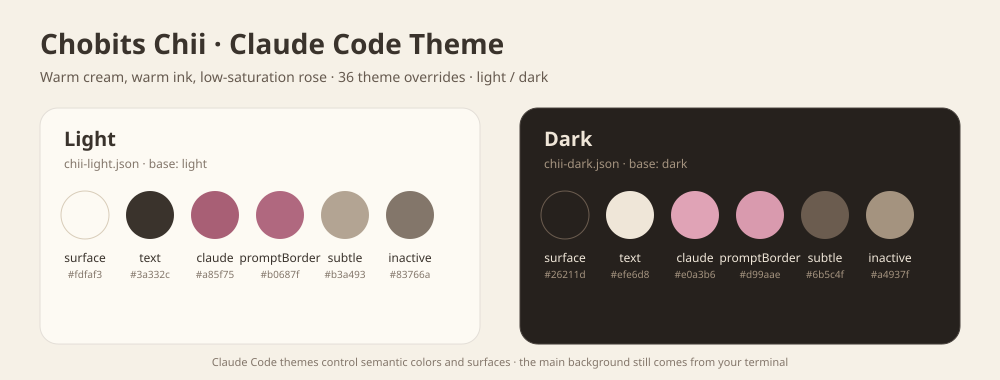

<div align="center">
  <h1>Chobits-Chii-Claude</h1>
  <p><b>ちぃ～</b> Claude Code をちぃの暖色テーマに</p>
  <p>Claude Code 向けのちぃ柄テーマプラグインです。</p>
  <p>
    <a href="https://github.com/Anime2Real/Chobits-Chii-Claude"></a>
    <a href="LICENSE"></a>
    <a href="https://github.com/topics/claude-code"></a>
    <a href="https://github.com/topics/claude-plugin"></a>
    <a href=".claude-plugin/plugin.json"></a>
  </p>
  <p>
    <a href="./README.md">简体中文</a> ｜ <a href="./README.ja.md">日本語</a> ｜ <a href="./README.en.md">English</a>
  </p>
</div>

<p align="center">
  
</p>

> **本リポジトリは配色値とプラグインスクリプトのみを含み、キャラクターのイラスト、Live2D モデル、その他のビジュアルアセットは含みません。** 配色は [Chobits-Chii-DSH](https://github.com/Anime2Real/Chobits-Chii-DSH) の MIT コードから [Chobits-Chii-Kimi](https://github.com/Anime2Real/Chobits-Chii-Kimi) を経て Claude Code 向けに移植しました。Chobits およびちぃ（Chii）の著作権は CLAMP ならびに権利者に帰属します。

> **Claude Code のプラグインテーマはまだ experimental です。** テーマは `/theme` から手動で選択します。プラグインが代わりに切り替えることはなく、システムのライト / ダーク設定にも追従しません。ターミナルの背景色はターミナルエミュレーター側の設定で決まり、テーマでは変更できません。

## ✨ 機能

- **ニュートラルな暖色パレット**：暖かいクリーム色、暖かいインク色の文字、低彩度のローズ系アクセント。長時間のターミナル作業でも読みやすいコントラストに調整
- **ライト / ダークの 2 テーマ**：`chii-light` と `chii-dark`。それぞれ `base` を `light` / `dark` に設定し、未指定のトークンは対応する組み込みパレットを継承
- **36 個のテーマトークン**：ブランド色、本文、枠線、モード表示、diff、メッセージ背景、使用量メーター、ラベル、shimmer をカバー
- **プラグインとして配布**：1 つの `.claude-plugin/plugin.json` にテーマ、スラッシュコマンド、Skill、marketplace マニフェストを収録
- **テーマのネイティブ検出**：Claude Code がプラグイン直下の `themes/` を走査し、`/theme` に一覧表示します。Kimi 版のような同期 Hook は不要です
- **依存ゼロ**：検証スクリプトは Node 標準モジュールのみ。ビルド手順も実行時依存もありません
- **検証可能**：`scripts/validate.mjs` がマニフェスト、marketplace、Skill / Command の frontmatter、トークン名、色値をチェック

## 🚀 インストール

Claude Code が必要です（本リポジトリは **2.1.326** で検証とローカルインストールを実施）。Claude Code のセッションで実行します：

```text
/plugin marketplace add Anime2Real/Chobits-Chii-Claude
/plugin install chobits-chii@chobits-chii
```

インストール後に実行：

```text
/theme
```

テーマ選択画面で次のいずれかを選びます：

- `Chobits Chii (Light)`
- `Chobits Chii (Dark)`

### ローカル開発

```bash
claude --plugin-dir ./Chobits-Chii-Claude
```

起動後は同じく `/theme` から選択します。ローカルのソースを編集したらセッションを再起動してください。

### テーマファイルのみをインストール

プラグインを使わず配色だけ使う場合：

```bash
mkdir -p ~/.claude/themes
cp themes/*.json ~/.claude/themes/
```

プラグインと手動コピーの両方が存在すると、`/theme` に同名テーマが重複表示されます。どちらか一方にしてください。

### アンインストール

```bash
claude plugin uninstall chobits-chii@chobits-chii
```

`/plugin` の **Installed** タブからも削除できます。`~/.claude/themes/` にコピーしたカスタムテーマは削除されません。

## 🎨 使い方

| コマンド | 説明 |
| --- | --- |
| `/theme` | テーマ選択画面で `Chobits Chii (Light)` / `Chobits Chii (Dark)` を選択 |
| `/chobits-chii:theme` | テーマを検証し、切り替え方法を案内 |
| `/chobits-chii:chobits-chii` | プラグイン Skill を読み込み、適用とカスタマイズの説明を表示 |
| `claude plugin validate .` | マニフェスト、パス、テーマファイルを検証 |
| `claude --plugin-dir .` | インストールせずローカルディレクトリから読み込み |

テーマの選択は対話操作です。プラグインが代わりに切り替えたと主張してはいけません。本プラグインはテーマを自動切り替えしません。カスタムテーマは `/theme` から手動で選択してください。

## 🔧 仕組み

Claude Code はプラグインが提供するテーマをネイティブにサポートしています。プラグイン直下の `themes/` が走査され、`/theme` に表示されます。そのため Kimi 版の `SessionStart` 同期 Hook は不要です：

```text
.claude-plugin/plugin.json
├─ themes/chii-light.json   ──▶  /theme → Chobits Chii (Light)
├─ themes/chii-dark.json    ──▶  /theme → Chobits Chii (Dark)
├─ commands/theme.md        ──▶  /chobits-chii:theme
└─ skills/chobits-chii/     ──▶  /chobits-chii:chobits-chii
```

インストールすると、Claude Code はリポジトリをプラグインキャッシュへコピーし、テーマもプラグインと一緒に読み込みます。`/theme` は開くたびに利用可能なテーマを再読み込みし、`~/.claude/themes/` の変更は自動で監視・再読み込みされます。

## 🧩 配色

両テーマは 36 個のトークンを上書きします。主要な対応は以下の通りです（完全な値は [`themes/chii-light.json`](themes/chii-light.json) と [`themes/chii-dark.json`](themes/chii-dark.json) を参照）：

| トークン | Light | Dark | 用途 |
| --- | --- | --- | --- |
| `claude` | `#a85f75` | `#e0a3b6` | ブランド強調、spinner、assistant ラベル |
| `text` | `#3a332c` | `#efe6d8` | 本文、ダイアログ、Markdown |
| `inactive` | `#83766a` | `#a4937f` | 補助テキスト、ヒント、タイムスタンプ |
| `subtle` | `#b3a493` | `#6b5c4f` | 淡い枠線、区切り線、記号 |
| `promptBorder` | `#b0687f` | `#d99aae` | 入力ボックスの枠線 |
| `planMode` | `#b0687f` | `#d99aae` | Plan モードの強調 |
| `bashBorder` | `#b0687f` | `#d99aae` | `!` Shell モードの枠線 |
| `diffAdded` | `#e8f0e2` | `#1f2b22` | 追加行の背景 |
| `diffRemoved` | `#f6e4e6` | `#332226` | 削除行の背景 |
| `userMessageBackground` | `#f3eae1` | `#2c2520` | ユーザーメッセージの背景 |
| `selectionBg` | `#e6d3d6` | `#4a383c` | マウス選択の背景 |
| `rate_limit_fill` | `#a85f75` | `#e0a3b6` | 使用量メーターの塗り |
| `briefLabelYou` | `#a85f75` | `#e0a3b6` | ユーザーラベル |
| `claudeShimmer` | `#c68fa1` | `#f2c6d2` | spinner のグラデーション |

`success`、`error`、`warning` などの意味色は上書きせず、Claude Code の組み込み値をそのまま使います。状態の意味を保つためです。

### Kimi からのトークン対応

| Kimi トークン | Claude トークン |
| --- | --- |
| `primary` | `claude` |
| `text` | `text` |
| `textMuted` | `inactive` |
| `border` | `subtle` |
| `borderFocus` | `promptBorder` |
| `roleUser` | `briefLabelYou` |
| `shellMode` | `bashBorder` |
| `diffGutter` / `diffMeta` | 直接の対応なし。diff の背景色と文字色で表現 |

Claude Code のテーマはメッセージ、入力欄、diff などの意味的な背景を制御しますが、**ターミナルのメイン背景はターミナルエミュレーター側の設定**です。DSH スキンのクリーム色ページ背景、写真ウォール、ノイズテクスチャ、丸ゴシック、選択状態、Live2D デスクトップマスコットは本リポジトリに含まれません。Claude Code のテーマには Web UI を注入する機能がないためです（画面全体のスタイル変更には Claude Code mod という別 API が必要です）。

## 🎨 カスタマイズ

プラグインキャッシュ内のテーマを直接編集しないでください。更新時に上書きされます。ユーザーテーマディレクトリへコピーして編集します：

```bash
mkdir -p ~/.claude/themes
cp themes/chii-light.json ~/.claude/themes/chii-light-mine.json
$EDITOR ~/.claude/themes/chii-light-mine.json
```

- ファイル名と `name` を一緒に変更します（例：`"Chii Light Mine"`）。プラグインのテーマと重複しないようにするためです
- `base` は `light` または `dark` のままにし、`overrides` だけを編集します
- 使用できる色値：`#rrggbb`、`#rgb`、`rgb(r,g,b)`、`ansi256(n)`、`ansi:<name>`。不明なトークンと不正な値は無視されます
- Claude Code は `~/.claude/themes/` を監視し、保存後に自動で再読み込みします。起動時にディレクトリが存在しなかった場合は、作成後に一度再起動してください
- 既定値を変更して提案する場合は、`themes/*.json` を編集し、`node scripts/validate.mjs` を実行してから PR を送ってください

## 🛠 開発

```bash
node scripts/validate.mjs                               # マニフェスト / marketplace / テーマのローカル検証
npx @anthropic-ai/claude-code plugin validate .         # Claude Code 公式検証
npx @anthropic-ai/claude-code --plugin-dir .            # ローカルディレクトリから読み込み
```

ディレクトリ構成：

```text
.claude-plugin/plugin.json      # Claude Code プラグインマニフェスト
.claude-plugin/marketplace.json # marketplace マニフェスト
themes/chii-light.json          # ライトテーマ
themes/chii-dark.json           # ダークテーマ
commands/theme.md               # /chobits-chii:theme
skills/chobits-chii/SKILL.md    # プラグイン Skill
scripts/validate.mjs            # マニフェストとテーマの検証、Node 標準モジュールのみ
assets/icon.svg / icon.png      # プラグインアイコン
docs/palette.svg                # README の配色プレビュー
LICENSE                         # MIT
NOTICE                          # 配色の出典とキャラクター権利の表記
```

`--plugin-dir` でローカル読み込みする場合、ソース編集後はセッションを再起動してください。marketplace からインストールしたコピーは、再インストールまたはバージョン更新が必要です。

## 🧱 互換性と制限

- **テーマは experimental**：Claude Code はプラグインテーマを `experimental.themes` の下に置いており、フィールドやトークンは変更される可能性があります
- **ターミナル UI のみ**：テーマは Claude Code のターミナル描画に作用します。デスクトップの Code タブや VS Code 拡張では、それぞれのバージョンの対応範囲に依存します
- **背景は変わらない**：ターミナルのメイン背景はターミナル側の設定です。Claude テーマは意味的な背景のみを上書きします
- **ライト / ダークの自動切り替えなし**：`/theme` から手動で選択します
- **テーマの自動選択なし**：プラグインをインストールしてもテーマは有効になりません
- **カスタムテーマはユーザーディレクトリ**：`~/.claude/themes/` を使い、プラグインキャッシュは編集しないでください
- **インストールスコープ**：user / project / local スコープに対応。チームはプロジェクト単位でバージョンを固定できます

## 🗺 ロードマップ

- **v1.0.0（現在）**：2 テーマ、プラグインマニフェスト、marketplace、コマンド、Skill、検証スクリプト
- **v1.1**：コントラストとアクセシビリティの監査、高コントラスト / 低彩度バリアント
- **v1.2**：Claude Code プラグインディレクトリへの掲載、スクリーンショットとテーマプレビュー
- **今後**：Codex 版と配色ソースを共有し、ターミナル間でちぃの見た目を揃える

## 🏠 Anime2Real について

[Anime2Real](https://github.com/Anime2Real) は、「二次元キャラクター」を実際に動くものにする開発者グループです。デスクトップマスコット、音声、Live2D、3D、対話モデルまで、素材制作からインストール可能な成果物までをオープンソースで作っています。ちぃ（Chii）は最初のキャラクターで、このテーマは Claude Code における彼女の居場所のひとつです。

- 組織ページ：[github.com/Anime2Real](https://github.com/Anime2Real)
- ちぃをデスクトップで動かす：[Chobits-Chii-Mascot](https://github.com/Anime2Real/Chobits-Chii-Mascot) / [リリース](https://anime2real.github.io/Chobits-Chii-Mascot-Release/)
- 声を与える：[Chobits-Chii-TTS](https://github.com/Anime2Real/Chobits-Chii-TTS) · [Chobits-Chii-ASR](https://github.com/Anime2Real/Chobits-Chii-ASR)
- モデルの作り方を見る：[Chobits-Chii-Live2D](https://github.com/Anime2Real/Chobits-Chii-Live2D)
- 参加する：各リポジトリの issue はオープンです。アイデア、不具合報告、PR を歓迎します。Star も見つけてもらう助けになります

## 🔗 ちぃファミリー

| プロジェクト | 説明 |
| --- | --- |
| [Chobits-Chii-Claude](https://github.com/Anime2Real/Chobits-Chii-Claude) | Claude Code 向けちぃテーマプラグイン（本リポジトリ） |
| [Chobits-Chii-Kimi](https://github.com/Anime2Real/Chobits-Chii-Kimi) | Kimi Code CLI 向けちぃテーマプラグイン（移植元） |
| [Chobits-Chii-DSH](https://github.com/Anime2Real/Chobits-Chii-DSH) | DeepSeek Harness Web UI 向けちぃスキンプラグイン（配色元） |
| [Chobits-Chii-Mascot](https://github.com/Anime2Real/Chobits-Chii-Mascot) | デスクトップマスコット（Electron + Live2D） |
| [Chobits-Chii-Mascot-Release](https://github.com/Anime2Real/Chobits-Chii-Mascot-Release) | デスクトップマスコットの公開リリースと[製品ページ](https://anime2real.github.io/Chobits-Chii-Mascot-Release/) |
| [Chobits-Chii-TTS](https://github.com/Anime2Real/Chobits-Chii-TTS) | ちぃ音声合成モデル |
| [Chobits-Chii-ASR](https://github.com/Anime2Real/Chobits-Chii-ASR) | ちぃ音声認識サービス |
| [Chobits-Chii-LLM](https://github.com/Anime2Real/Chobits-Chii-LLM) | ちぃ日本語対話 LLM |
| [Chobits-Chii-Live2D](https://github.com/Anime2Real/Chobits-Chii-Live2D) | ちぃ Live2D モデルとモーション素材 |

## 📄 ライセンス

**コードとテーマ JSON は [MIT](./LICENSE) で公開されています。本リポジトリにキャラクター素材は含まれません。**

- **コードとテーマ**：`.claude-plugin/`、`themes/`、`commands/`、`skills/`、`scripts/`、`assets/` は MIT
- **配色の出典**：[Chobits-Chii-DSH](https://github.com/Anime2Real/Chobits-Chii-DSH) の MIT コードに由来します。同プロジェクトのイラスト、Live2D モデル、その他の素材は本リポジトリにコピーしていません
- **キャラクターの権利**：ちぃ（Chii）と『Chobits』の著作権は CLAMP ならびに権利者に帰属します。Anime2Real はこれらの権利を主張せず、許諾することもできません
- **サードパーティランタイムなし**：Live2D Cubism Core、pixi などのランタイムは含みません

詳細は [LICENSE](./LICENSE) と [NOTICE](./NOTICE) を参照してください。
