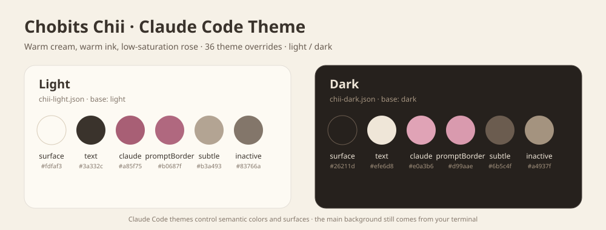

<div align="center">
  <h1>Chobits-Chii-Claude</h1>
  <p><b>叽～</b> 把 Claude Code 终端界面换成小叽的暖色主题</p>
  <p>A Chii-themed theme plugin for the Claude Code terminal UI.</p>
  <p>
    <a href="https://github.com/Anime2Real/Chobits-Chii-Claude"></a>
    <a href="LICENSE"></a>
    <a href="https://github.com/topics/claude-code"></a>
    <a href="https://github.com/topics/claude-plugin"></a>
    <a href=".claude-plugin/plugin.json"></a>
  </p>
  <p>
    <a href="./README.md">简体中文</a> ｜ <a href="./README.ja.md">日本語</a> ｜ <a href="./README.en.md">English</a>
  </p>
</div>

<p align="center">
  
</p>

> **说明：本仓库只包含配色与插件脚本，不包含角色插画、Live2D 模型或其他视觉资产。** 配色取自 [Chobits-Chii-DSH](https://github.com/Anime2Real/Chobits-Chii-DSH) 的 MIT 代码，并经 [Chobits-Chii-Kimi](https://github.com/Anime2Real/Chobits-Chii-Kimi) 移植到 Claude Code。Chobits 与小叽（Chii）的著作权归 CLAMP 及相关权利方所有。

> **当前版本只覆盖 Claude Code 的终端界面（TUI / CLI）。** Claude Desktop 的 Code tab 需要单独的 mod（`$.theme.set`，改色需 v2.1.324+），本插件暂未包含；VS Code 扩展不在本插件覆盖范围内。

> **Claude Code 的插件主题仍在 `experimental` 阶段。** 主题通过 `/theme` 手动选择；插件不能替用户自动切换，本插件也不提供跟随系统明暗的自动切换。终端主背景由你的终端模拟器决定，不受主题控制。

## ✨ 功能特性

- **暖色中性配色**：暖奶油底、暖墨文字、低饱和玫瑰点缀，色板收敛到适合长时间阅读的终端对比度
- **明暗双主题**：`chii-light` 与 `chii-dark` 两套 Claude Code 终端主题，分别以 `light` / `dark` 为 base，未覆盖的 token 自动继承对应内置色板
- **36 个主题 token**：覆盖品牌色、正文、边框、模式指示、diff、消息背景、用量条、标签与 shimmer
- **插件化分发**：一个 `.claude-plugin/plugin.json` 同时打包主题、Slash 命令、Skill 和 marketplace 清单
- **原生主题发现**：Claude Code 会在终端界面扫描插件根目录的 `themes/`，`/theme` 直接列出，不需要 Kimi 版那样的同步 Hook
- **零依赖**：校验脚本只用 Node 内置模块，没有构建步骤、没有运行时依赖
- **可校验**：`scripts/validate.mjs` 检查清单、marketplace、Skill/Command frontmatter、token 名与颜色格式

## 🚀 安装

要求已安装 Claude Code（本仓库在 **2.1.326** 上完成校验与本地安装测试）。在 Claude Code 会话中执行：

```text
/plugin marketplace add Anime2Real/Chobits-Chii-Claude
/plugin install chobits-chii@chobits-chii
```

安装完成后输入：

```text
/theme
```

在主题选择器里选择：

- `Chobits Chii (Light)`
- `Chobits Chii (Dark)`

主题只在 Claude Code 的终端界面生效。Claude Desktop 的 Code tab 需要单独的 mod，本插件不会自动应用。

### 本地开发

```bash
claude --plugin-dir ./Chobits-Chii-Claude
```

启动后同样用 `/theme` 选择。修改本地源码后重启会话即可重新加载。

### 只安装主题文件

如果只想用主题、不安装插件，也可以直接复制 JSON：

```bash
mkdir -p ~/.claude/themes
cp themes/*.json ~/.claude/themes/
```

如果插件和手动主题同时存在，`/theme` 里会出现同名主题；保留一种即可。

### 卸载

```bash
claude plugin uninstall chobits-chii@chobits-chii
```

也可以在 `/plugin` 面板的 **Installed** 标签页卸载。卸载只删除插件副本，不会删除你复制到 `~/.claude/themes/` 的自定义主题。

## 🎨 使用

| 方式 | 说明 |
| --- | --- |
| `/theme` | 打开主题选择器，选择 `Chobits Chii (Light)` 或 `Chobits Chii (Dark)` |
| `/chobits-chii:theme` | 插件命令：校验主题并提示如何切换 |
| `/chobits-chii:chobits-chii` | 加载插件 Skill，查看应用与自定义说明 |
| `claude plugin validate .` | 校验插件清单、路径与主题文件 |
| `claude --plugin-dir .` | 不安装，直接从本地目录加载插件 |

主题选择必须在 `/theme` 面板里完成；插件不会声称已经替用户切换。本插件不提供自动明暗切换，自定义主题需要在 `/theme` 中手动选择。

## 🔧 工作原理

Claude Code 原生支持插件贡献主题：插件根目录的 `themes/` 会被扫描，`/theme` 会把它们列在自定义主题里。因此本插件不需要 Kimi 版的 `SessionStart` 同步 Hook：

```text
.claude-plugin/plugin.json
├─ themes/chii-light.json   ──▶  /theme → Chobits Chii (Light)
├─ themes/chii-dark.json    ──▶  /theme → Chobits Chii (Dark)
├─ commands/theme.md        ──▶  /chobits-chii:theme
└─ skills/chobits-chii/     ──▶  /chobits-chii:chobits-chii
```

插件安装后，Claude Code 会把仓库复制到插件缓存，主题文件随插件一起加载。`/theme` 每次打开都会重新读取可用主题；编辑 `~/.claude/themes/` 里的文件会被自动监听并重载。

## 🧩 配色

两套主题覆盖 36 个 token，以下为主要映射（完整值见 [`themes/chii-light.json`](themes/chii-light.json) 与 [`themes/chii-dark.json`](themes/chii-dark.json)）：

| Token | Light | Dark | 主要用途 |
| --- | --- | --- | --- |
| `claude` | `#a85f75` | `#e0a3b6` | 品牌强调、spinner、assistant 标签 |
| `text` | `#3a332c` | `#efe6d8` | 正文、对话框、Markdown |
| `inactive` | `#83766a` | `#a4937f` | 次要文字、提示、时间戳 |
| `subtle` | `#b3a493` | `#6b5c4f` | 淡边框、分隔线、符号 |
| `promptBorder` | `#b0687f` | `#d99aae` | 输入框边框 |
| `planMode` | `#b0687f` | `#d99aae` | Plan 模式强调 |
| `bashBorder` | `#b0687f` | `#d99aae` | `!` Shell 模式边框 |
| `diffAdded` | `#e8f0e2` | `#1f2b22` | 新增行背景 |
| `diffRemoved` | `#f6e4e6` | `#332226` | 删除行背景 |
| `userMessageBackground` | `#f3eae1` | `#2c2520` | 用户消息背景 |
| `selectionBg` | `#e6d3d6` | `#4a383c` | 鼠标选中背景 |
| `rate_limit_fill` | `#a85f75` | `#e0a3b6` | 用量条填充 |
| `briefLabelYou` | `#a85f75` | `#e0a3b6` | 用户标签 |
| `claudeShimmer` | `#c68fa1` | `#f2c6d2` | spinner 渐变高光 |

`success`、`error`、`warning` 等语义色没有覆盖，继续使用 Claude Code 内置值，保证状态含义清晰。

### 从 Kimi 迁移的 token 映射

| Kimi token | Claude token |
| --- | --- |
| `primary` | `claude` |
| `text` | `text` |
| `textMuted` | `inactive` |
| `border` | `subtle` |
| `borderFocus` | `promptBorder` |
| `roleUser` | `briefLabelYou` |
| `shellMode` | `bashBorder` |
| `diffGutter` / `diffMeta` | 没有直接对应；改用 diff 背景与文字色表达 |

Claude Code 主题控制消息区、输入区、diff 等语义背景，但**终端主背景仍由终端模拟器决定**。原 DSH 皮肤里的暖奶油页面背景、照片墙、噪点纹理、圆体字、选中态和 Live2D 桌宠没有包含在本仓库中，因为 Claude Code 主题没有 Web UI 注入能力（如需整界面改样式，要用 Claude Code mod，属于另一套 API）。

## 🎨 自定义

不要直接改插件缓存里的主题文件，插件更新会覆盖。推荐复制到用户主题目录再改：

```bash
mkdir -p ~/.claude/themes
cp themes/chii-light.json ~/.claude/themes/chii-light-mine.json
$EDITOR ~/.claude/themes/chii-light-mine.json
```

- 改文件名后同时改 `name`，例如 `"Chii Light Mine"`，避免和插件主题重名
- 保留 `base` 为 `light` 或 `dark`，只改 `overrides`
- 支持 `#rrggbb`、`#rgb`、`rgb(r,g,b)`、`ansi256(n)`、`ansi:<name>`；未知 token 和非法值会被忽略
- Claude Code 监听 `~/.claude/themes/`，保存后自动生效；如果启动时目录不存在，创建后重启一次
- 想改默认值并提交回仓库时，编辑 `themes/*.json` 后运行 `node scripts/validate.mjs`，再提交 PR

## 🛠 开发

```bash
node scripts/validate.mjs                               # 本地校验清单、marketplace、主题
npx @anthropic-ai/claude-code plugin validate .         # Claude Code 官方校验
npx @anthropic-ai/claude-code --plugin-dir .            # 从本地目录加载
```

目录结构：

```text
.claude-plugin/plugin.json      # Claude Code 插件清单
.claude-plugin/marketplace.json # marketplace 清单
themes/chii-light.json          # 浅色主题
themes/chii-dark.json           # 深色主题
commands/theme.md               # /chobits-chii:theme
skills/chobits-chii/SKILL.md    # 插件 Skill
scripts/validate.mjs            # 清单与主题校验，仅 Node 内置模块
assets/icon.svg / icon.png      # 插件图标
docs/palette.svg                # README 配色预览
LICENSE                         # MIT
NOTICE                          # 配色来源与角色权利说明
```

本地用 `--plugin-dir` 时改源码后重启会话即可；通过 marketplace 安装的副本需要重新安装或等版本更新。

## 🧱 兼容性与限制

- **主题仍是 experimental**：Claude Code 把插件主题放在 `experimental.themes` 下，字段和 token 可能随版本变化
- **仅 TUI / CLI**：当前 `themes/` JSON 只影响 Claude Code 的终端界面；Claude Desktop 的 Code tab 需要 mod 的 `$.theme.set`（改色需 v2.1.324+），本版本未包含；VS Code 扩展不在本插件覆盖范围内
- **背景不随主题变化**：终端主背景由终端主题决定；Claude 主题只覆盖语义背景
- **无自动明暗切换**：需要手动在 `/theme` 中选择
- **插件主题不能自动选中**：安装后仍需用户打开 `/theme`
- **自定义主题放在用户目录**：`~/.claude/themes/`，不要改插件缓存
- **项目级安装**：插件支持 user/project/local 作用域，团队可在项目里固定版本

## 🗺 路线图

- **v1.0.1（当前）**：双主题（TUI）、插件清单、marketplace、命令、Skill、校验脚本

## 🏠 关于 Anime2Real

[Anime2Real](https://github.com/Anime2Real) 是一群把「二次元角色」做成能真正跑起来的东西的开发者：桌宠、语音、Live2D、3D、对话模型，一路从素材生产做到能安装的成品，全部开源。小叽（Chii）是我们的第一个角色，这个主题是她在 Claude Code 里的一个落脚点。

- 组织主页：[github.com/Anime2Real](https://github.com/Anime2Real)
- 想看小叽在桌面上活起来：[Chobits-Chii-Mascot](https://github.com/Anime2Real/Chobits-Chii-Mascot) / [发布页](https://anime2real.github.io/Chobits-Chii-Mascot-Release/)
- 想给她一副嗓子：[Chobits-Chii-TTS](https://github.com/Anime2Real/Chobits-Chii-TTS) · [Chobits-Chii-ASR](https://github.com/Anime2Real/Chobits-Chii-ASR)
- 想看模型怎么做出来的：[Chobits-Chii-Live2D](https://github.com/Anime2Real/Chobits-Chii-Live2D)
- 想参与：每个仓库的 issue 都开着，欢迎提想法、报问题、交 PR；点个 Star 也能让更多人找到我们

## 🔗 小叽家族

| 项目 | 说明 |
| --- | --- |
| [Chobits-Chii-Claude](https://github.com/Anime2Real/Chobits-Chii-Claude) | Claude Code 终端小叽主题插件（本仓库） |
| [Chobits-Chii-Kimi](https://github.com/Anime2Real/Chobits-Chii-Kimi) | Kimi Code CLI 小叽主题插件（本仓库的移植参考） |
| [Chobits-Chii-DSH](https://github.com/Anime2Real/Chobits-Chii-DSH) | DeepSeek Harness Web UI 小叽皮肤插件（配色来源） |
| [Chobits-Chii-Mascot](https://github.com/Anime2Real/Chobits-Chii-Mascot) | 桌面精灵客户端（Electron + Live2D） |
| [Chobits-Chii-Mascot-Release](https://github.com/Anime2Real/Chobits-Chii-Mascot-Release) | 桌面精灵公开发布渠道与[产品主页](https://anime2real.github.io/Chobits-Chii-Mascot-Release/) |
| [Chobits-Chii-TTS](https://github.com/Anime2Real/Chobits-Chii-TTS) | 小叽语音合成模型 |
| [Chobits-Chii-ASR](https://github.com/Anime2Real/Chobits-Chii-ASR) | 小叽语音识别服务 |
| [Chobits-Chii-LLM](https://github.com/Anime2Real/Chobits-Chii-LLM) | 小叽日语对话 LLM |
| [Chobits-Chii-Live2D](https://github.com/Anime2Real/Chobits-Chii-Live2D) | 小叽 Live2D 模型与动作资产 |

## 📄 许可证

**代码与主题 JSON 以 [MIT](./LICENSE) 发布；本仓库不包含角色资产。**

- **代码与主题**：`.claude-plugin/`、`themes/`、`commands/`、`skills/`、`scripts/`、`assets/` 均为 MIT
- **配色来源**：色板取自 [Chobits-Chii-DSH](https://github.com/Anime2Real/Chobits-Chii-DSH) 的 MIT 代码；该项目的插画、Live2D 模型和其他资产没有复制到本仓库
- **角色形象**：小叽（Chii）与《人形电脑天使心》的著作权归 CLAMP 及相关权利方所有；Anime2Real 不主张、也无法授予这些权利
- **无第三方运行时**：本仓库不包含 Live2D Cubism Core、pixi 或其他第三方运行时

详见 [LICENSE](./LICENSE) 与 [NOTICE](./NOTICE)。
